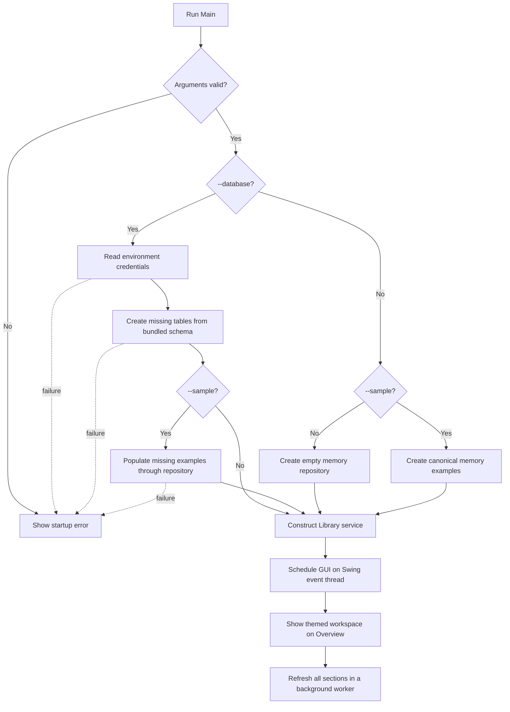

# 3. Behavior Design

**Document ID:** LMS-BHV

**Purpose:** dynamic design supplement to [Section 2](architecture.md#2-software-design-description).

## 3.1. Startup sequence

Launch configuration is defined in [Section 5.1](user-guide.md#51-launch); connection provisioning
is defined in [LMS-DB](../database/README.md).

## 3.2. Refresh sequence

A background worker requests one LibrarySnapshot, then LibraryRecords maps the report
to table rows. The completion handler updates all Swing sections and overview values
on the event thread. Navigation remains usable while record-changing actions and
Refresh all are disabled. Filters remain attached to their table views.

## 3.3. Checkout sequence

The service evaluates the eligibility rules in [Section 1.4](requirements.md#14-business-rules) before
calling the repository. A rejected write does not publish the proposed loan.

## 3.4. Edit, return, and archive sequences

Forms collect input on the event thread. Cancellation ends the operation before any
service call. Confirmed operations run in a worker and validate proposed changes
before writing. A return persists its date before mutating the supplied loan.
Editing and archive changes likewise save before publishing changed object state.
A successful operation requests a fresh reporting snapshot.

## 3.5. Export sequence

The event thread captures the displayed rows and column order. An export worker
writes UTF-8 data to a same-directory temporary file, moves the completed file to
the chosen destination, and removes remaining temporary data. An existing destination
is rejected. Export never changes repository records.

## 3.6. Failure and shutdown sequences

Startup failures end launch with an error. Operation failures are reported by the
window. Save success followed by refresh failure is reported distinctly: the saved
operation is not rolled back. A connection loss during writing can leave the result
uncertain; operator recovery is specified in [Section 5.7](user-guide.md#57-recover-from-errors-and-close).

Close waits for active record/export work. A temporary session requires discard
confirmation. On accepted close, column widths and normal-mode window dimensions
are saved independently of library records.
