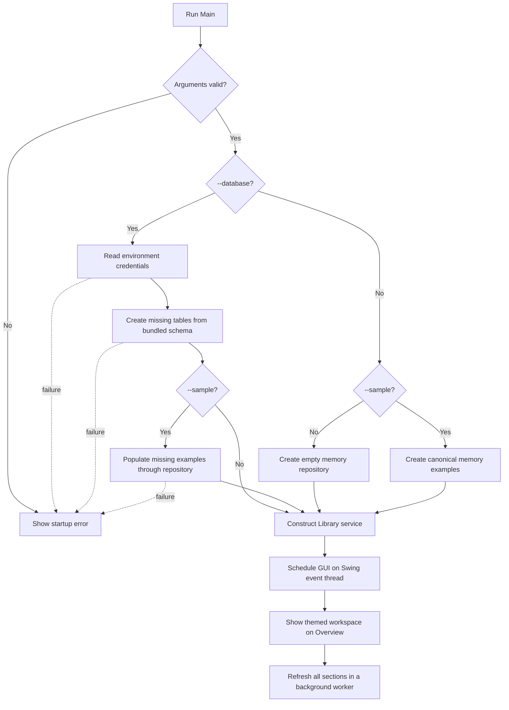
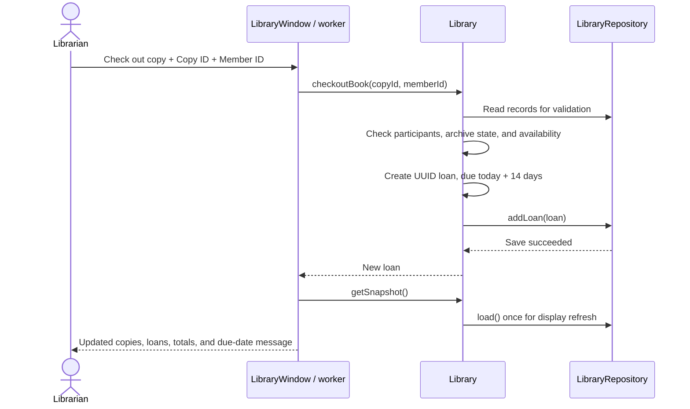
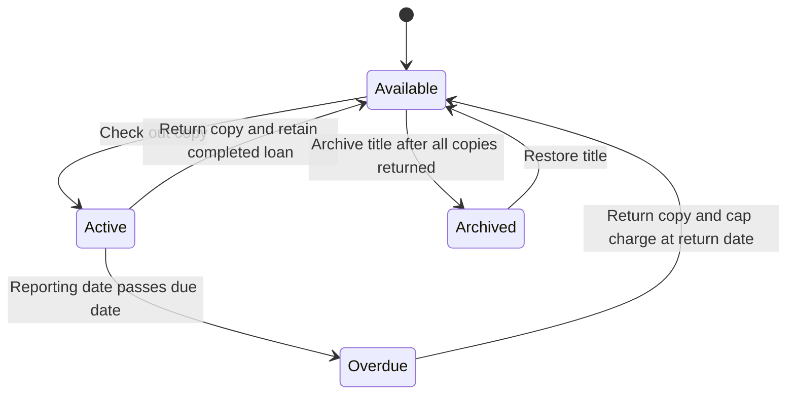

# Application flow

## Startup

A graphical display is required. Headless environments can run checks and render
preview panels, but cannot operate the native application window.

## Navigation and refresh

The sidebar opens Overview, Books, Copies, Members, or Loans. The current section
explains its purpose. Search, status choice, and sorting affect the table view;
they do not change stored records. Navigation remains available during background
work, while record-changing actions and Refresh all are disabled.

A workspace refresh obtains one LibrarySnapshot. Its records, reporting date,
and fine rate feed all table rows, statuses, and overview totals. The snapshot is
prepared outside the event thread; tables and summary cards update together on
that thread. Refresh preserves filter selections.

## Add and edit

1. Choose the relevant section and an add/register action, or select a row to edit.
2. Complete the form. Existing details are prefilled for editing; identifiers stay fixed.
3. Cancel closes the form without calling the service.
4. On confirmation, the background worker calls Library.
5. Model/service validation runs before the repository write.
6. Success refreshes the workspace; rejection shows an error without changing existing data.

## Borrow a copy

An archived title or already borrowed copy is rejected. A storage failure does
not publish a successful checkout in memory. Database mode also has a unique
constraint preventing two active loans for the same copy.

## Return and late charges

The date transition is calculated when records are read; there is no scheduler
that writes an overdue flag. A return locates the active loan and validates the
return date. The repository saves first, then marks the supplied object returned.
History remains visible and the late charge stops increasing.

## Archive and restore

Select a title, choose Archive or Restore, and confirm. Cancellation does nothing.
Archive is rejected while any copy of that title has an active loan. The change
applies to lending eligibility for every copy, without deleting records. Restore
re-enables unborrowed copies. Repeating an already applied transition is harmless.

## Export

Export CSV captures displayed rows and column order after filtering and sorting.
The user chooses a new filename. A background worker writes UTF-8 data to a
same-directory temporary file, moves the completed file into place, and removes
any remaining temporary file. Existing destinations are rejected. Export success
or failure appears in a dialog; library records are unchanged.

## Error and close paths

- Startup errors appear before the workspace; no silent fallback to memory occurs.
- A save may succeed while the following display refresh fails. The message asks
  the user to refresh before repeating an action, because the save was not undone.
- A connection lost during a write can leave its outcome uncertain; reload before retrying.
- Close is deferred while a record or export operation runs. Temporary sessions ask before
  discarding records. Persistent sessions close without deleting saved data.
- Sample population commits individual additions. Successful additions remain if
  a later insert fails; rerunning population resumes from existing records.
