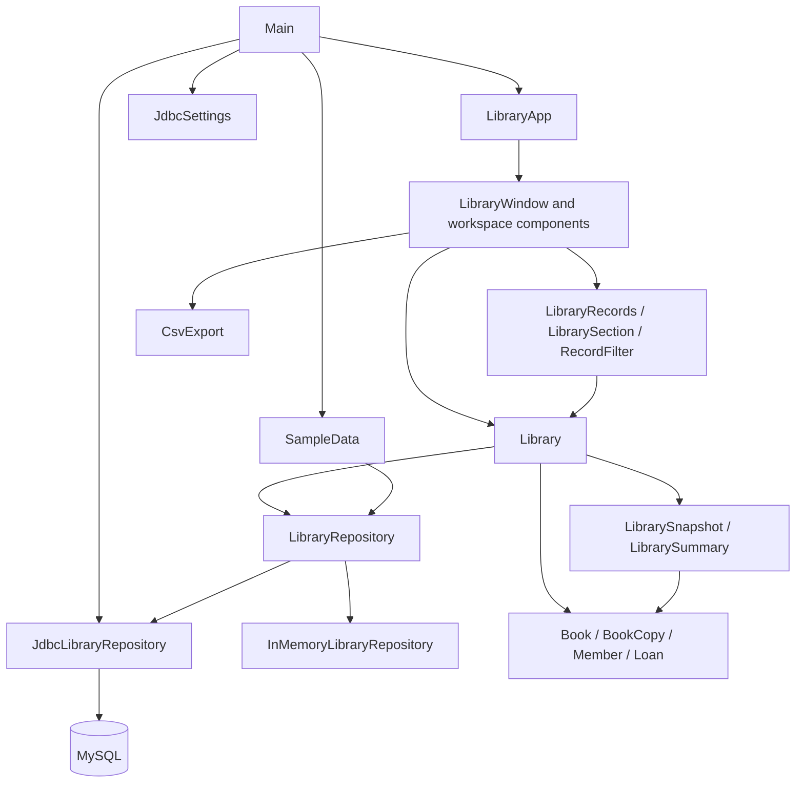

# Architecture

## Design reference

Use the [schema and its foreign keys](data-model.md#schema-first-design-reference)
as the starting point for stored fields and relationships. Models, repository
mapping, service workflows, and GUI record sections build on that definition.
The GUI presents readable relationships through Library rather than running SQL.

## Component boundaries

Main coordinates startup only. A repository instance is selected once and passed
to Library. Temporary mode uses an empty or example-populated memory repository;
MySQL mode uses JDBC and explicitly initializes missing tables before the GUI starts.

## Packages

| Package | Responsibility |
| --- | --- |
| `com.daniel.library` | Entry point and launch flags |
| `demo` | Canonical sample fixture and repeatable population |
| `model` | Identity, local validation, and domain state |
| `service` | Workflow validation, date/fine policy, reporting snapshots, LibraryRepository, and LibraryData |
| `persistence` | Memory/JDBC storage implementations and connection configuration |
| `ui` | Desktop startup, window, workspace, components, styling, display data, and CSV export |
| `images/` | Versioned UI reference screenshots at the project root |

UI source lives directly in ui; tests use the same package. SQL and database setup documentation live
in `database/`. Generated classes and API documentation are excluded from Git. UI reference screenshots
are versioned in `images/`.

## Write ownership

Library validates application workflows. The service package defines LibraryRepository
and LibraryData: the storage contract and its related record result. The persistence
package supplies the memory and JDBC implementations.
Models do not perform I/O. Repository inserts assume service-validated records;
SampleData intentionally uses that low-level contract to add historical examples.

Memory storage retains shared entities so editing a Book or Member updates the
references held by copies and loans. JDBC hydrates related objects together using
identifier maps. Each SQL write commits independently through a short-lived
connection. The return operation saves its date before changing the caller's loan.

## Read ownership and reporting

Library.getSnapshot captures one repository load, one clock date, and the configured
fine rate. LibrarySnapshot owns availability, late-charge, overdue, and overview
calculations for that report. LibraryRecords maps them to display rows without
opening additional connections per copy or loan.

JDBC load uses a repeatable-read transaction for a related data view. Lists are
read-only; entities inside them remain mutable, especially in memory mode. This
is an operation-scoped reporting view, not an immutable historical snapshot.
Read methods load the full dataset.

## Desktop composition

- LibraryApp installs the theme and schedules Swing construction.
- LibraryWindow wires forms, record actions, worker lifecycle, and close handling.
- LibraryWorkspace owns sidebar navigation, page cards, storage badge, and status footer.
- SectionPanel supplies the title, explanation, and action area.
- UiPreferences stores optional local layout sizes independently of library records.
- CheckoutForm selects copy/member identities from the latest display snapshot; Library revalidates checkout before saving.
- OverviewDashboard highlights values already present in overview rows.
- RecordTable owns read-only tables, sorting, search, status filters, and export selection.
- RecordCellRenderer and LibraryTheme centralize visual presentation.

A SwingWorker runs record operations and refresh mapping outside the event thread.
Its completion handler updates components on the event thread. Export captures a
view snapshot there, then writes files in a separate worker. Assertions can inspect
these components headlessly; native focus and modal behavior require a real display.

## Error and operational boundaries

SQLExceptions are wrapped in user-readable IllegalStateExceptions with original
causes retained. Main shows startup errors and LibraryWindow shows workflow errors.
Credentials are read from environment variables and hidden from settings.toString().

There is no connection pool, application login, background scheduler, schema
migration framework, or multi-writer conflict manager. Use one running instance.
A schema initializer creates missing tables only. Database outage never switches
the application to memory silently. Packaging is an IntelliJ/Maven project, not
an installer or self-contained executable JAR.
