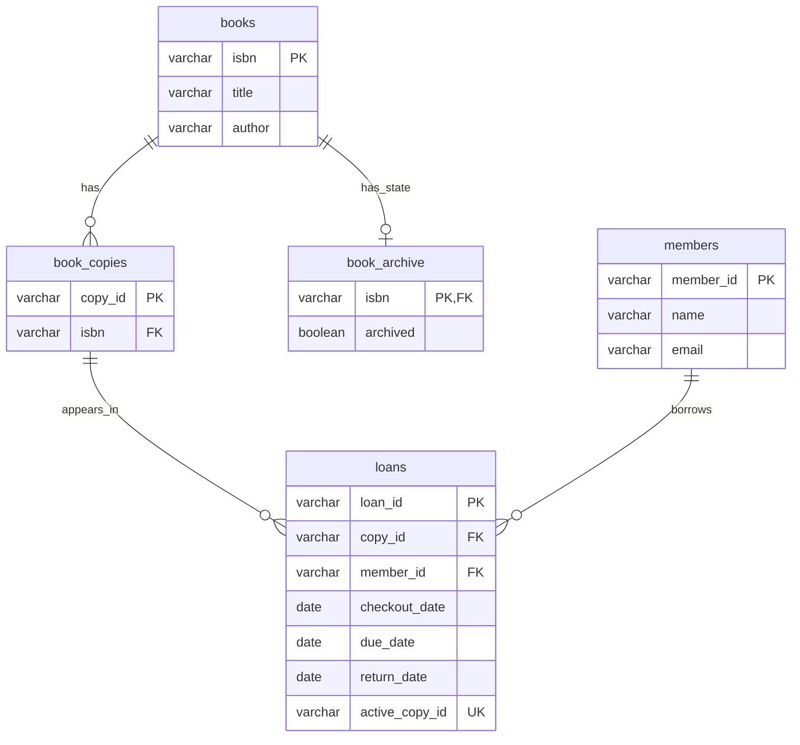

# Data model and persistence

The authoritative DDL is [database/schema.sql](../database/schema.sql). It is bundled
as `/database/schema.sql` by Maven. Database creation remains separate in
[create-database.sql](../database/create-database.sql).

## Schema-first design reference

For this design, start with the schema: tables identify stored records, columns
identify their stored fields, primary keys identify records, and foreign keys
identify relationships. Model objects represent those fields and links; JDBC maps
the objects to rows; Library applies workflows; GUI sections display each record's
fields in order, inserting related details immediately after each foreign-key ID
before continuing with the remaining fields.

| Foreign key | Model relationship | Related GUI information |
| --- | --- | --- |
| book_copies.isbn → books.isbn | BookCopy.book | Book title and author in Copies |
| loans.copy_id → book_copies.copy_id | Loan.copy | Copy ID, then book ISBN/title/author in Loans |
| loans.member_id → members.member_id | Loan.member | Member ID, then borrower name in Loans |
| book_archive.isbn → books.isbn | Book.archived | Active/Archived catalog status |

A book's copies, a member's borrowing, and a copy's current borrower are reverse
lookups through these foreign keys. Model relationships use objects rather than
repeating every foreign-key ID as another mutable field. Calculated availability,
loan status, and fines come from those records and policy. The generated
`active_copy_id` exists to enforce a database constraint; it is not a user-entered
model field or GUI column. None of these displays requires duplicating stored data.

## Tables and limits

| Table | Stored fields and constraints |
| --- | --- |
| books | ISBN VARCHAR(64) primary key; title VARCHAR(500), author VARCHAR(300), both required |
| book_archive | ISBN VARCHAR(64) primary/foreign key; required archived boolean; missing row means active |
| book_copies | Copy ID VARCHAR(64) primary key; required ISBN foreign key |
| members | Member ID VARCHAR(64) primary key; required name VARCHAR(300) and email VARCHAR(320) |
| loans | Loan ID VARCHAR(36) primary key; required copy/member foreign keys and checkout/due dates; nullable return date |

The schema uses InnoDB and utf8mb4 with utf8mb4_bin collation. SQL field lengths
are storage limits, not matching model length validators. Avoid identifiers with
surrounding whitespace: GUI forms trim entries, and database string comparison
semantics can differ from Java equality for trailing spaces.

## Active borrowing constraint

`active_copy_id` is a stored generated column: copy_id while return_date is null,
otherwise null. Its unique index allows only one active loan per copy while
allowing multiple returned records. It is not entered or exported as a separate
application identifier.

CHECK constraints require due_date on/after checkout_date and a return date that
is null or on/after checkout. The service additionally checks participants,
availability, and archive policy before saving.

## Identity and history

BookCopy is a record with `copyId()` and `book()` accessors. Its components cannot
be reassigned, but the referenced Book can still be edited. Record equality compares
both components; Book uses object identity. BookCopy references Book; Loan references BookCopy and Member. Application loans
receive UUIDs, while canonical sample loans have fixed IDs. Updating title/contact
fields retains identity. Book archive state is stored in book_archive, keyed by ISBN. Restore updates archive state without deleting history.

Overdue status, availability, fine amount, and overview totals are calculated;
they are not redundant status columns. The daily fine rate and currency are not
stored per loan, and no payments table exists. Current configuration must remain
consistent when interpreting historical charges.

## Persistence semantics

- One load reconstructs a connected entity graph inside a read transaction.
- Individual writes use prepared statements and commit independently.
- Active and returned loans can be inserted; sample/historical return dates are retained.
- Memory lists are copied on read, but contained entities are shared and mutable.
- Sample population uses one Java fixture. It preserves existing IDs, edits,
  archive state, and borrowing; skips incompatible copy identities or active-loan
  conflicts; and can resume after partial failure.
- The schema initializer creates absent tables; it does not upgrade existing table definitions.
- There is no hard-delete workflow in the application. The separate live test removes
  only the uniquely named records it created in the dedicated test database.

See the [database guide](../database/README.md) for account privileges, credentials,
setup, and optional example population on macOS and Windows.
