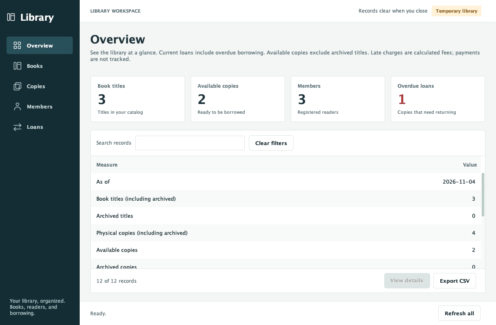
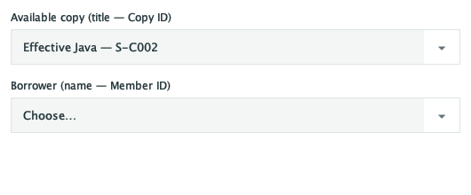

# 5. User Documentation

**Document ID:** LMS-USR

**Audience:** librarian operating the desktop application.

## 5.1. Launch

Open the project in IntelliJ, reload Maven, and select JDK 27 for the project,
module, and run configuration. Run `com.daniel.library.Main` on a graphical desktop.

| Program arguments | Session |
| --- | --- |
| None | Empty temporary library |
| `--sample` | Temporary library with examples |
| `--database` | Saved MySQL library |
| `--database --sample` | Saved library with missing examples added |

For saved storage, complete [database installation](../database/README.md) first.
The header identifies Temporary library or Saved library. Temporary records are
lost on close. Use one running instance at a time.

## 5.2. Register records and lend a copy

1. In Books, choose Add book and enter ISBN, title, and author.

2. Select the title and choose Add copy. Enter a unique Copy ID; the title is fixed.
   Alternatively, use Add copy in Copies and supply its ISBN.

3. In Members, choose Register member and enter Member ID, name, and email.

4. In Copies, select an Available row and choose Check out selected copy.

5. Choose a registered member explicitly and confirm. Read the due-date message.

6. To return it, select its Active or Overdue row in Loans and choose Return selected loan.

7. Confirm the copy and borrower. Use Returned or All to view completed borrowing.

Checkout choices contain available copies and registered members. If choices are
empty, add or return a copy, restore a title, or register a member as appropriate.
Canceling a form or confirmation leaves records unchanged.

## 5.3. Find and interpret records

Books initially selects Active; Loans selects Current. Current includes overdue
borrowing. Search matches literal text across displayed columns. Search and status
filters combine; Clear filters removes search and member scope and selects All.
Refresh retains filters. Click headings to sort; numbers and dates use their value order.

| Section | Display order |
| --- | --- |
| Books | ISBN, Title, Author, Status, Copies, Current borrowers |
| Copies | Copy ID, ISBN, Title, Author, Status, Member ID, Borrower, Due |
| Members | Member ID, Name, Email, Current loans |
| Loans | Loan ID, Copy ID, ISBN, Title, Author, Member ID, Member, Checked out, Due, Returned, Status, Fine |

Foreign-key details follow their IDs. Copies is a physical-copy count in Books;
Current loans is a count in Members. Copies shows borrower details only while lent.
Scroll wide tables horizontally. Hover for full cell text or use View details.

To inspect possession, select a member and choose View current loans. Loans opens
scoped to that exact Member ID. The scope label remains visible across refreshes;
choose Returned for that member's history or Clear filters for all members.
Same-name borrowers remain distinguished by Member ID.

## 5.4. Edit and archive

Select a book or member and choose its Edit action. Update descriptive fields and
confirm; ISBN and Member ID remain fixed. Invalid input is rejected without replacing
existing details. Actions are disabled until the selection is eligible and while
background record work is in progress.

To archive a title, return its borrowed copies, select it in Books, and confirm
Archive selected book. Find it under Archived and choose Restore selected book to
resume lending. Editing its description does not restore it. Archive eligibility
and retained history are specified in [Section 1.4](requirements.md#14-business-rules).

## 5.5. Read the overview

Overview presents totals and separates current and returned late charges.
For calculation policy, identifiers, and status definitions, see
[Section 1.4](requirements.md#14-business-rules). These charges do not represent payment balances.

## 5.6. Export a report

Set search, status, sorting, and column order, then choose Export CSV. Select a new
filename in an existing folder. Export includes the displayed member scope; empty
results contain headers only. The app adds `.csv` if needed and preserves existing files.

## 5.7. Recover from errors and close

Refresh all reloads every section. If a save succeeded but refresh failed, refresh
before repeating the action. After a connection loss during saving, reload or restart
to determine the saved result before retrying. Use the
[LMS-DB, Section 13](../database/README.md#13-if-connection-fails) for connection errors.
Report the exact message without sharing passwords.

Wait for background work before closing. Confirm discard when leaving a temporary
session. Saved sessions retain records in MySQL.

## 5.8. Local layout settings

Closing remembers column widths and normal-mode window size. Reopening centers the
window and bounds its size to the current screen; column widths follow headers.
Settings contain sizes only, stored at `.library-management-system/ui.properties`
in the user home folder (`/Users/your-name` on macOS, typically `C:\Users\your-name`
on Windows). Close the app and delete this file to reset layout. Missing or
unreadable settings use defaults.
